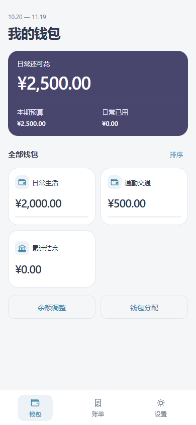
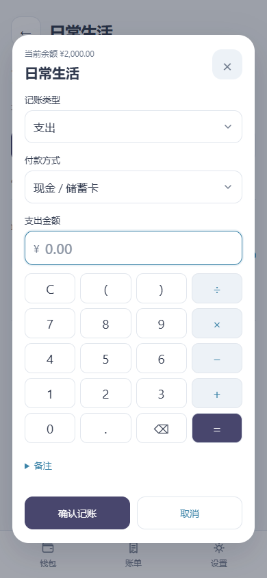

# 花在哪


**把工资分进几个钱包，花钱时点钱包、填金额。**

一个简单、实用的单机记账应用，支持 Android 和浏览器。日常操作是：**打开 → 点钱包 → 选支出、收入或退款 → 填金额 → 保存**。首页总览各钱包，具体操作和流水放在钱包详情中。

[下载安卓安装包](https://github.com/BitPulse10/hua-zai-na/releases/latest) · [使用说明](docs/usage.md) · [Android 构建说明](android-app/README.md)

## 为什么做它

发工资后，很多人已经知道这笔钱要怎么用：一部分日常花，一部分交房租，一部分存起来。花在哪把这个安排直接做成首页的钱包。先安排钱的用途，再从对应的钱包记消费。

## 简单，具体体现在哪

### 1. 点钱包就能记账

例如吃饭花了 25 元，点“日常生活”进入详情，选择“支出”，填 25，保存。金额可以用加减乘除计算；备注可先不填，之后在流水中补充或修改。首页卡片不放管理按钮，钱包顺序可以手动调整并保存。

### 2. 发工资怎么分，钱包就怎么设

填写每月实际到手工资，再给钱包安排金额。比如到手 6000 元，给日常生活 2000 元、长期储蓄每月自动存入 2000 元，“钱包分配”页就能看到还剩 2000 元没有分配。分配超过工资时会提示，避免在账面上安排出不存在的钱。

“钱包分配”集中安排各钱包的每月额度，“余额调整”集中填写现在实际剩余的钱。中途开始使用或修正填错的余额都不会推算消费：预算 2000、余额设为 1000，但没记过消费时，本月已用仍为 0。收入增加余额，不抵消已用；退款恢复余额并冲减实际消费。

### 3. “每月花的钱”和“慢慢存的钱”分得清

| 钱包 | 怎么变化 | 用途举例 |
| --- | --- | --- |
| 每月预算 | 到发薪日恢复设定额度，剩余的钱归入累计结余 | 日常生活、交通 |
| 长期储蓄 | 已有余额一直保留，可设置每月存入，也能临时多存一笔 | 存款、攒季度房租 |
| 会员储值 | 充值增加、消费减少，不随发薪日重置 | 理发卡、餐饮储值卡 |

预算周期跟着发薪日走。例如每月 20 日发薪，本月就是 20 日到下月 19 日；刷新小时也可以自己设。累计结余能查看流水，再转入长期储蓄。

### 4. 计划消费先等你确认

房租、AI 订阅等计划挂在付款钱包上，可设一次、每月、每季度或每年。到期先生成待确认账单，确认后才记入支出；退订或没有实际付款时可以取消，不会因为计划到期就悄悄减少余额。

### 5. 回头看，也只看需要的信息

账单可以看今日、本周、本月、本年度和历史发薪周期；月度按日看，年度按月看，也能展开逐笔记录。钱包的余额、超支和待处理事项都有对应明细。

信用卡消费会同时扣用途钱包的可用金额、增加信用卡待还；实际还款只减少待还，不重复扣钱包或重复算消费。钱包不足也可记账，但会显示负余额和还款资金缺口。

### 6. 打开就能用，数据自己留着

不需要注册、登录或准备服务器。首次打开从空白引导开始，没有预置工资、钱包和示例消费。Android 版内置全部页面资源，没有网络权限；账本存本机，通过 JSON 导入导出备份。浏览器版也使用本地存储。

## 界面预览

 

截图使用演示数据。当前源码版本为 2.1.0；已发布的 Android 安装包仍为 2.0.3，新版安装包尚待使用原发布密钥签名构建。

## 使用

### Android

到 [Releases](https://github.com/BitPulse10/hua-zai-na/releases/latest) 下载 APK，传到手机后安装。支持 Android 6.0 及以上版本，首次启动按引导填写工资和发薪日，再创建钱包，也可以导入已有 JSON 备份。

### 浏览器

源码不需要前端构建。克隆仓库后，用任意静态服务器打开根目录，例如已安装 Python 时：

```sh
python -m http.server 8787
```

浏览器访问 `http://localhost:8787`。不同浏览器与站点地址分别保存账本；换设备前先导出备份。PWA 离线缓存需要 HTTPS 或 localhost。

## 使用前需要知道

- 计划消费不会连接银行或支付平台实际扣款。
- 应用关闭后不会后台执行或发送系统通知；重新打开、回到前台时会补齐错过的发薪周期和到期计划。
- 数据不自动上传或同步。卸载 Android 应用、清除应用数据或清理浏览器站点数据前，请先导出备份。
- Android 2.0.3 已完成发布构建和签名校验；尚未在实体 Android 设备上验证。
- 正式版可与早期旧版 Android 应用并存。旧版账本不能跨应用自动读取，请保留旧应用；迁移限制见 [Android 说明](android-app/README.md#从旧版-apk-转移数据)。

## 源码与构建

- `index.html`、`styles.css`、`app.js`：页面与记账逻辑，原生 HTML/CSS/JavaScript，无前端运行依赖。
- `android-app/`：Java WebView 容器，将同一份网页资源打入 APK；本机原子文件保存账本，系统文件选择器负责备份导入导出。
- `tests/functional.cjs`：Playwright 浏览器功能回归，使用隔离测试账本，覆盖首次引导、周期刷新、旧备份、余额调整、收入退款、信用卡、排序与计算器等行为。

Android 构建、签名和备份接口见 [构建说明](android-app/README.md)。仓库不包含发布签名密钥、个人账本、构建缓存和 SDK。

## 开源协议

[MIT](LICENSE)。欢迎报告具体操作步骤、预期结果与实际结果；请勿在 Issue 中上传未经脱敏的个人账本。
